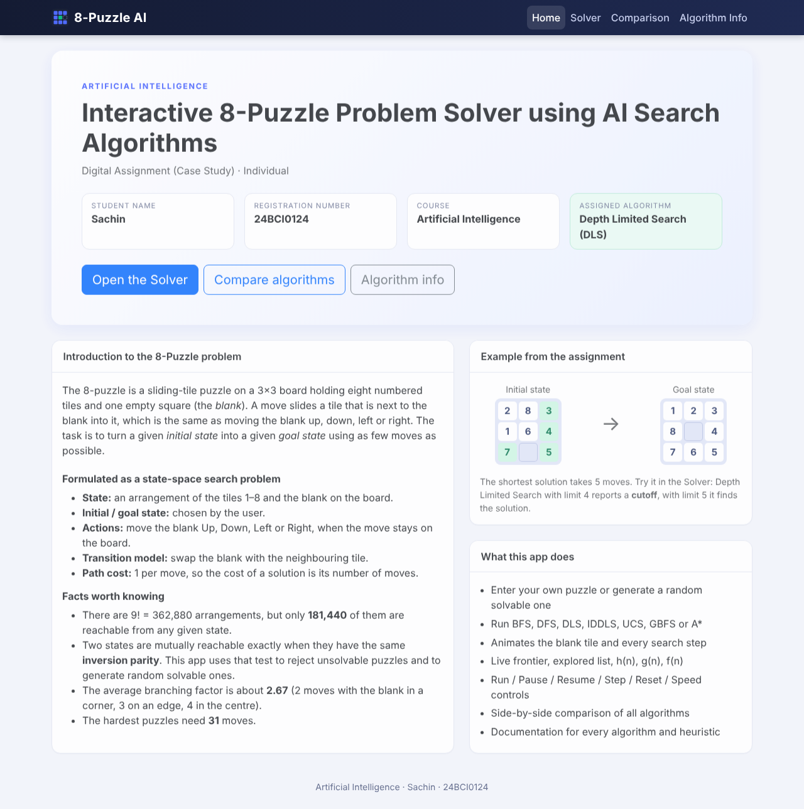
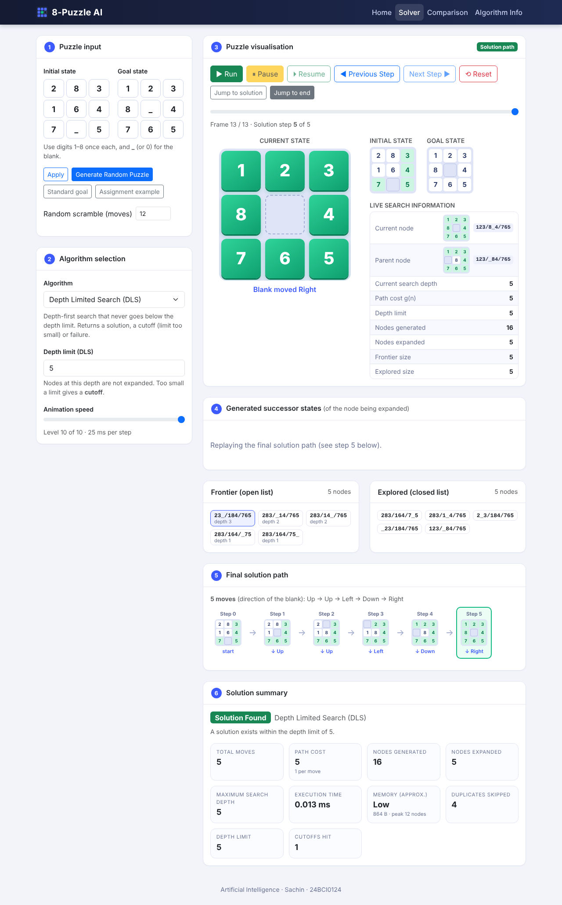
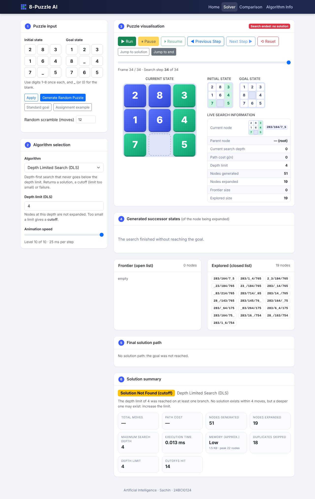
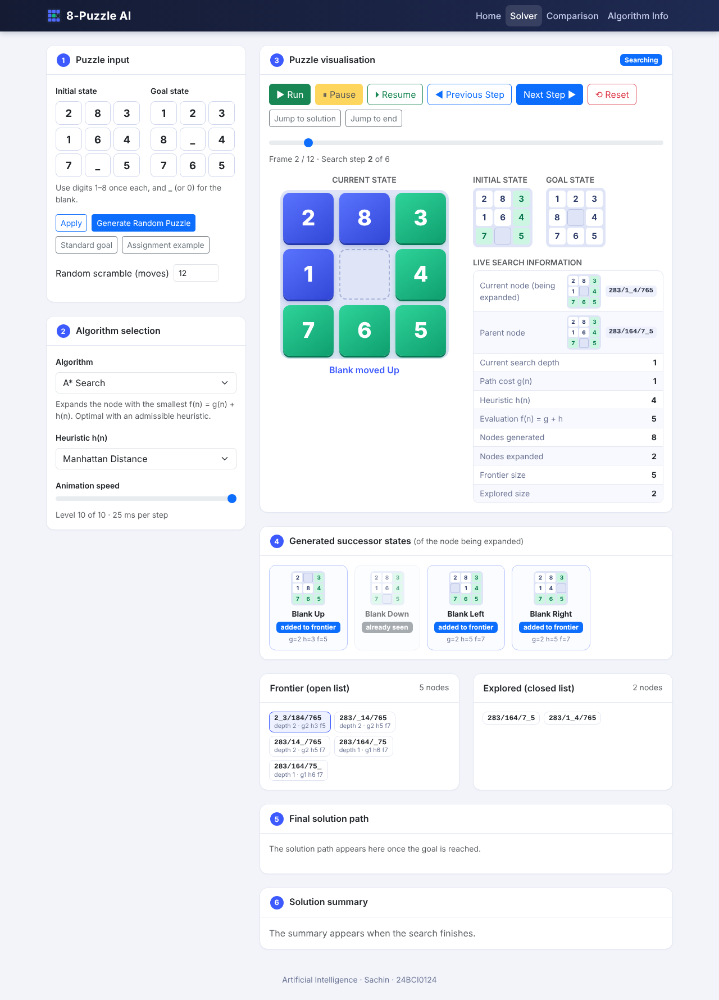
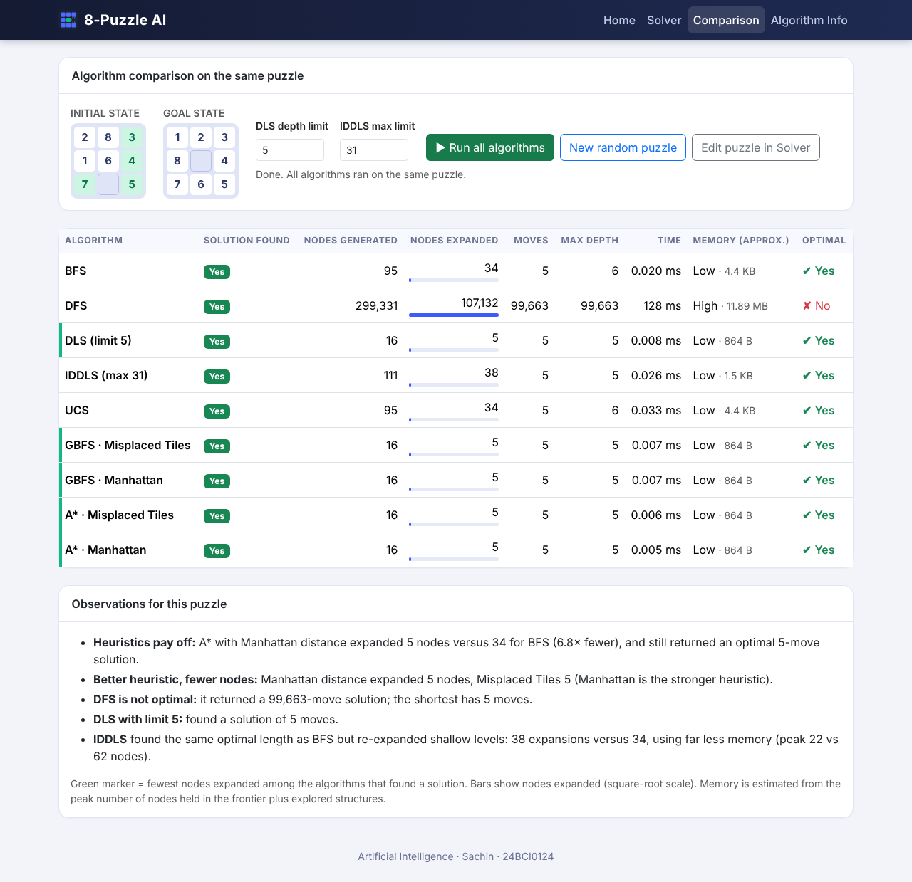

# AI 8-Puzzle Visualizer

**Interactive 8-Puzzle Problem Solver using AI Search Algorithms**
Course: Artificial Intelligence · Digital Assignment (Case Study) · Individual

🚀 **LIVE DEMO:** https://ssohammishra0911.github.io/AI-8Puzzle-Visualizer1/

📦 **SOURCE CODE:** https://github.com/Ssohammishra0911/AI-8Puzzle-Visualizer1

---

## Project description

A web application that solves the 8-Puzzle as a state-space search problem and **animates how each algorithm searches**: the blank tile slides across the board, the successors of every expanded node are shown, and the frontier (open list) and explored list (closed list) update live. All search algorithms are implemented **from scratch in JavaScript** (no search libraries).

The algorithm assigned to me (register number **24BCI0124**) is **Algorithm 3: Depth Limited Search (DLS)**. The remaining algorithms are included so that the comparison page and the algorithm documentation can cover all of them.

### Features

| Page | What it offers |
|---|---|
| **Home** | Course, assignment title, student name, registration number, introduction to the 8-Puzzle, navigation menu |
| **Solver** | Two ways to create a puzzle (type initial + goal states, or *Generate Random Puzzle* which is always solvable); algorithm selection with depth-limit input for DLS and heuristic selection for GBFS / A\*; animated board; successor states; live search panel; solution path; solution summary; Run / Pause / Resume / Next Step / Previous Step / Reset / Speed controls |
| **Comparison** | Runs every algorithm on the same puzzle and tabulates solution found, nodes generated / expanded, moves, depth, time, memory and optimality, with auto-generated observations |
| **Algorithm Info** | Description, working principle, advantages, limitations, time and space complexity, completeness and optimality for every algorithm, plus both heuristics |

Live search information shown while the algorithm runs: current node being expanded, parent node, current depth, path cost, nodes generated, nodes expanded, frontier, explored list, and (for GBFS and A\*) h(n), g(n) and f(n).

Solution summary: solution found / not found (for DLS a **cutoff** is reported separately from a true failure), total moves, nodes generated, nodes expanded, maximum search depth, execution time, path cost and approximate memory usage.

## Technologies used

- HTML5, CSS3, JavaScript (ES6, no build step)
- Bootstrap 5.3 (CSS framework, loaded from the jsDelivr CDN)
- CSS transforms/transitions for the tile animation
- Hosting: GitHub Pages

## Search algorithms implemented

| Type | Algorithm | Data structure |
|---|---|---|
| Uninformed | Breadth First Search (BFS) | FIFO queue |
| Uninformed | Depth First Search (DFS) | LIFO stack + visited set |
| Uninformed | **Depth Limited Search (DLS)** *(assigned)* | LIFO stack, depth limit, returns solution / cutoff / failure |
| Uninformed | Iterative Deepening DLS (IDDLS) | repeated DLS with limit 0, 1, 2, … |
| Uninformed | Uniform Cost Search (UCS) | priority queue on g(n) |
| Informed | Greedy Best First Search (GBFS) | priority queue on h(n) |
| Informed | A\* Search | priority queue on f(n) = g(n) + h(n) |

Implementation notes (details in [`docs/DESIGN.md`](docs/DESIGN.md)):

- State = 9-character string (`"283164705"`, `0` is the blank). Successors are generated in the order Up, Down, Left, Right (direction of the blank).
- Every move costs 1, so g(n) equals the depth.
- **DLS** does not expand nodes at depth = limit. If any branch was cut off and no goal was found, the result is *cutoff* (a deeper solution may exist); if the whole space was exhausted it is *failure*. A state reached again through a **shallower** path is re-expanded, because a plain visited set would otherwise cause solutions within the limit to be missed.
- Unsolvable puzzles are rejected using inversion parity; random puzzles are produced by making random legal moves backwards from the goal, so they are always solvable.
- A safety limit of 1,000,000 node expansions stops runaway searches (only DLS / IDDLS can reach it).

## Heuristics used

- **Misplaced Tiles (h₁)**: number of tiles (blank excluded) not on their goal square.
- **Manhattan Distance (h₂)**: sum of row distance + column distance of every tile from its goal square.

Both are admissible and consistent, so A\* returns an optimal solution with either one. Manhattan dominates Misplaced Tiles (h₂ ≥ h₁) and therefore expands fewer nodes.

## Screenshots

| | |
|---|---|
|  *Home page* |  *DLS (limit 5) solving the example* |
|  *DLS (limit 4) reporting a cutoff* |  *A\* showing h(n), g(n), f(n)* |
|  *Comparison page* |  *Algorithm information* |

## How to run the project

**Online:** open the GitHub Pages URL above.

**Locally:** no installation is needed.

1. Download or clone the repository: `git clone https://github.com/YOUR-GITHUB-USERNAME/AI-8Puzzle-Visualizer.git`
2. Open `index.html` in a browser (double-click it), or serve the folder, e.g. `python -m http.server 8000` and visit http://localhost:8000.
3. An internet connection is needed only to load Bootstrap from the CDN.

**Quick tour:** open *Solver* → leave the example puzzle (from the assignment) → choose *DLS* → limit **4** → *Run* (cutoff) → limit **5** → *Run* (solved in 5 moves).

**Tests** (optional, needs Node.js 18+): `node tests/algorithms.test.js` checks the successor function, solvability test, heuristics, optimality of BFS / UCS / IDDLS / A\*, DLS cutoff behaviour and the trace recorder.

## Project structure

```
AI-8Puzzle-Visualizer/
├── index.html          # all pages (Home, Solver, Comparison, Algorithm Info)
├── css/style.css       # styling and tile animation
├── js/
│   ├── config.js       # student details shown on the Home page
│   ├── puzzle.js       # state model, successors, solvability, random puzzles
│   ├── heuristics.js   # Misplaced Tiles, Manhattan Distance
│   ├── algorithms.js   # BFS, DFS, DLS, IDDLS, UCS, GBFS, A* (+ trace recording)
│   ├── info.js         # text for the Algorithm Info page
│   └── ui.js           # navigation, board animation, controls, panels, comparison
├── assets/             # favicon
├── images/             # screenshots
├── docs/DESIGN.md      # design notes
├── tests/              # Node test suite
└── README.md
```

## Student details

| | |
|---|---|
| Name | Soham Mishra |
| Registration number | 24BCI0124 |
| Course | Artificial Intelligence |
| Assigned algorithm | Depth Limited Search (algorithm no. 3) |

## References

- S. Russell and P. Norvig, *Artificial Intelligence: A Modern Approach*, 4th ed., Pearson: state-space search, uninformed and informed search, heuristic functions.
- Course lecture material and the assignment sheet for the Artificial Intelligence course.
- Bootstrap 5 documentation, https://getbootstrap.com/
- MDN Web Docs (JavaScript, CSS transitions), https://developer.mozilla.org/

## Acknowledgements and AI assistance

Third-party resources: Bootstrap 5 (CSS framework only). No search or AI libraries are used; all algorithms are my own implementation in `js/algorithms.js`.

The code and documentation were developed with the help of an AI assistant (Claude by Anthropic), as permitted by the assignment note on AI usage. I reviewed, tested and can explain the implementation, and the project was verified with the included test suite and by running it in a browser.
